<picture>
  <source media="(max-width: 640px)" srcset="assets/profile-compact.svg">
  
</picture>

构建本地优先的开发者工具，关注 npm 供应链安全、开发环境诊断与浏览器工具。

**[个人网站 ↗](https://nisconder.pages.dev/)**　[技术文章](https://nisconder.pages.dev/articles/)　[全部项目](https://nisconder.pages.dev/software/)

### 我在做的工具

| 项目 | 用来解决什么 |
| :--- | :--- |
| **[npm-safe](https://github.com/nisconder/npm-safe)** TypeScript · 供应链安全 | 安装一个 npm 包前，先查看静态风险、归档内容与检测证据。覆盖 CLI、CI、桌面与 Agent 接口。 |
| **[portdoc](https://github.com/nisconder/portdoc)** JavaScript · 网络诊断 | 对比 localhost、IPv4 和 IPv6，定位 Windows、WSL 与 Docker 中的监听项目和映射。 |
| **[Pack Receipt](https://github.com/nisconder/pack-receipt)** JavaScript · 发布检查 | 在浏览器本地打开两个 npm 归档，看清文件、入口和内容的变化。 |
| **[Paste X-Ray](https://github.com/nisconder/paste-xray)** JavaScript · 文本取证 | 把零宽字符、双向控制符、同形字符与隐藏 HTML 显示出来，清理前先核对原因。 |
| **[8086 Step Lab](https://github.com/nisconder/8086-step-lab)** JavaScript · 交互学习 | 单步执行、回退，观察寄存器、标志位与内存。**[打开实验室 ↗](https://nisconder.github.io/8086-step-lab/)** |

### 代码之外，保留推理过程

我在 [个人网站](https://nisconder.pages.dev/) 记录工具实现、环境排查和系统学习笔记。最近把 [ICS / 8086 复习系列](https://nisconder.pages.dev/series/ics-8086/) 做成可动手观察的实验：从一个数的表示，追到一条指令带来的变化。

主要使用 **TypeScript / JavaScript**，也用 **Python / Java** 处理工具和实验。希望每个项目都能说清使用场景、给出可追溯证据，并保留验证范围与已知限制。

---

在本地检查，把问题看清。工具与文章持续更新于各自仓库。
