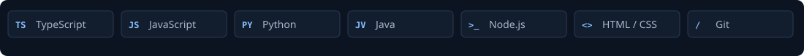
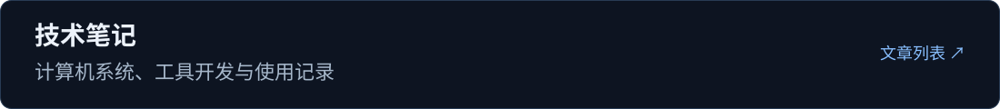

<picture>
  <source media="(max-width: 640px) and (prefers-color-scheme: light)" srcset="assets/hero-mobile-light.svg">
  <source media="(max-width: 640px)" srcset="assets/hero-mobile-dark.svg">
  <source media="(prefers-color-scheme: light)" srcset="assets/hero-light.svg">
  
</picture>

  <a href="https://nisconder.pages.dev/"><strong>个人网站 ↗</strong></a>　·　
  <a href="https://nisconder.pages.dev/articles/">技术文章</a>　·　
  <a href="https://nisconder.pages.dev/software/">全部项目</a>

<picture>
  <source media="(max-width: 640px) and (prefers-color-scheme: light)" srcset="assets/skills-mobile-light.svg">
  <source media="(max-width: 640px)" srcset="assets/skills-mobile-dark.svg">
  <source media="(prefers-color-scheme: light)" srcset="assets/skills-light.svg">
  
</picture>

<a href="https://github.com/nisconder?tab=overview">
<picture>
  <source media="(max-width: 640px) and (prefers-color-scheme: light)" srcset="assets/activity-mobile-light.svg">
  <source media="(max-width: 640px)" srcset="assets/activity-mobile-dark.svg">
  <source media="(prefers-color-scheme: light)" srcset="assets/activity-light.svg">
  
</picture>
</a>

<picture>
  <source media="(max-width: 640px) and (prefers-color-scheme: light)" srcset="assets/section-mobile-light.svg">
  <source media="(max-width: 640px)" srcset="assets/section-mobile-dark.svg">
  <source media="(prefers-color-scheme: light)" srcset="assets/section-light.svg">
  
</picture>

<a href="https://github.com/nisconder/npm-safe">
<picture>
  <source media="(max-width: 640px) and (prefers-color-scheme: light)" srcset="assets/cards/npm-safe-mobile-light.svg">
  <source media="(max-width: 640px)" srcset="assets/cards/npm-safe-mobile-dark.svg">
  <source media="(prefers-color-scheme: light)" srcset="assets/cards/npm-safe-light.svg">
  
</picture>
</a>

<a href="https://github.com/nisconder/portdoc">
<picture>
  <source media="(max-width: 640px) and (prefers-color-scheme: light)" srcset="assets/cards/portdoc-mobile-light.svg">
  <source media="(max-width: 640px)" srcset="assets/cards/portdoc-mobile-dark.svg">
  <source media="(prefers-color-scheme: light)" srcset="assets/cards/portdoc-light.svg">
  
</picture>
</a>

<a href="https://github.com/nisconder/paste-xray">
<picture>
  <source media="(max-width: 640px) and (prefers-color-scheme: light)" srcset="assets/cards/paste-xray-mobile-light.svg">
  <source media="(max-width: 640px)" srcset="assets/cards/paste-xray-mobile-dark.svg">
  <source media="(prefers-color-scheme: light)" srcset="assets/cards/paste-xray-light.svg">
  
</picture>
</a>

<a href="https://github.com/nisconder/pack-receipt">
<picture>
  <source media="(max-width: 640px) and (prefers-color-scheme: light)" srcset="assets/cards/pack-receipt-mobile-light.svg">
  <source media="(max-width: 640px)" srcset="assets/cards/pack-receipt-mobile-dark.svg">
  <source media="(prefers-color-scheme: light)" srcset="assets/cards/pack-receipt-light.svg">
  
</picture>
</a>

<a href="https://github.com/nisconder/8086-step-lab">
<picture>
  <source media="(max-width: 640px) and (prefers-color-scheme: light)" srcset="assets/cards/8086-lab-mobile-light.svg">
  <source media="(max-width: 640px)" srcset="assets/cards/8086-lab-mobile-dark.svg">
  <source media="(prefers-color-scheme: light)" srcset="assets/cards/8086-lab-light.svg">
  
</picture>
</a>

<a href="https://nisconder.github.io/8086-step-lab/">打开 8086 在线实验室 ↗</a>

<a href="https://nisconder.pages.dev/articles/">
<picture>
  <source media="(max-width: 640px) and (prefers-color-scheme: light)" srcset="assets/notes-mobile-light.svg">
  <source media="(max-width: 640px)" srcset="assets/notes-mobile-dark.svg">
  <source media="(prefers-color-scheme: light)" srcset="assets/notes-light.svg">
  
</picture>
</a>

  <a href="https://nisconder.pages.dev/series/ics-8086/">ICS / 8086 复习系列</a>　·　
  <a href="https://nisconder.pages.dev/">代码与生活的记录</a>

把问题看清，把过程留下。 · Nisconder

